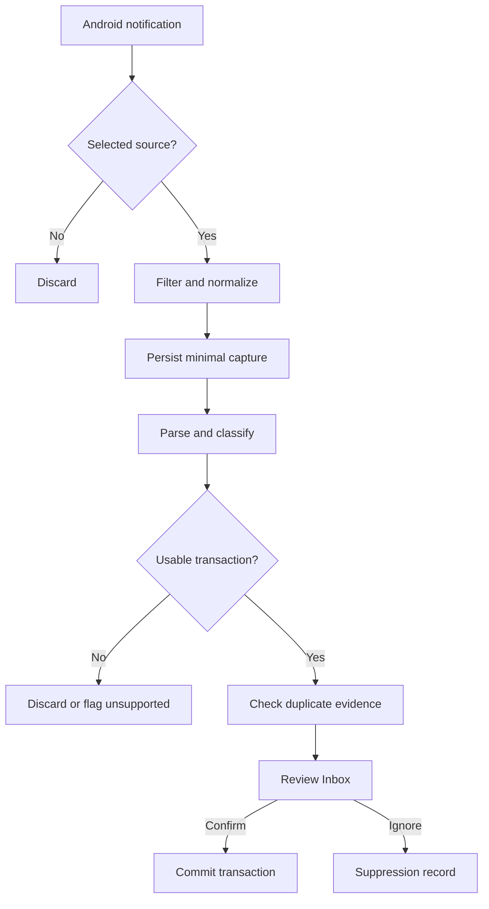
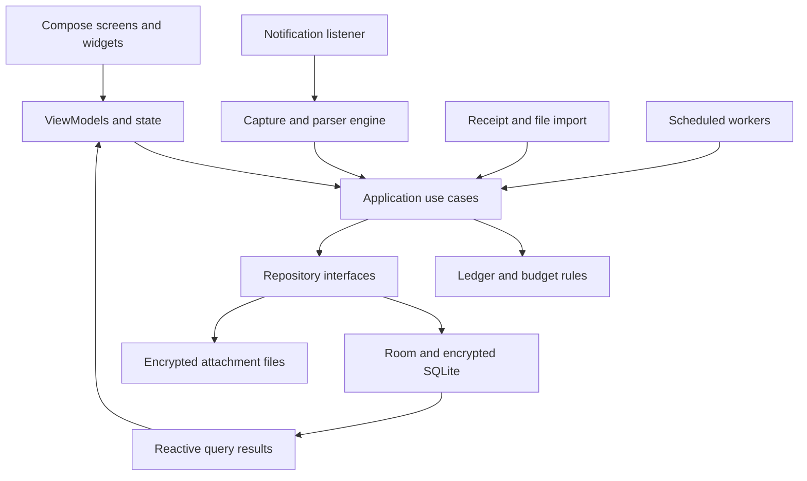

# MoneyLens — Product and System Architecture

Planning baseline: 8 October 2026. Android first, designed for personal use on a Samsung Galaxy S24 FE. Default currency MYR; default reporting timezone Asia/Kuala_Lumpur. This is a proposed design, not an implemented app or a claim of compatibility with particular bank notifications.

## 1. Product goal

Make recording money take a few seconds while keeping the user in control. Core features work without a network connection or account registration. Notifications, pasted text, receipts and imported files produce reviewable suggestions; only confirmed transactions affect balances and reports.

MoneyLens itself can work offline. Bank and wallet apps may need internet to receive the original payment notification. MoneyLens cannot infer purchases that never produce an accessible notification, and its account balances are recorded estimates until reconciled.

Initial scope: one person, one Android device, MYR accounting, bank/cash/wallet/card accounts, budgets, notification capture and encrypted backups. Keep extension points for foreign currencies, loans and desktop import/export, without building a server or synchronization system now.

## 2. Everyday experience

### First run

1. Set currency and monthly cycle, optionally starting on salary day.
2. Add Cash and any bank/wallet/card accounts. Opening balances are optional; accounts without one show an incomplete-balance indicator.
3. Use manual tracking immediately. Offer notification capture as an optional setup step.
4. Explain that Android notification access is broad; MoneyLens filters selected apps internally. An allowlist is an application rule, not a narrower OS permission.
5. Let the user select sources, then grant notification access in system settings and, separately, permission for MoneyLens to post prompts.
6. Show capture health and a demonstration using explicitly labelled synthetic data. Validate actual sources later using redacted real samples.
7. Offer app lock and guide the user through creating a recoverable encrypted backup.

### Example payment

Synthetic notification: “Payment of RM18.90 to ABC Cafe successful.”

MoneyLens proposes: RM18.90 · ABC Cafe · Food · chosen wallet · Today.

- Save: commit the proposal if required fields are certain and valid.
- Edit: open a compact review sheet with amount, account, merchant, category and date.
- Ignore: dismiss the suggestion and retain a minimal duplicate-suppression record.
- If incomplete or ambiguous, use Review rather than a misleading one-tap Save.

Use an ordinary actionable notification in the background and an in-app review card when MoneyLens is visible. Do not depend on automatic full-screen popups or draw-over-other-app permissions. A heads-up banner is subject to user settings and Android behavior, not guaranteed.

When device/app lock policy requires authentication, actions open the authenticated review screen. Hide amounts and merchants on the lock screen by default. Quiet hours and a daily summary reduce interruption. Swiping away a prompt leaves its draft in the Inbox.

### Main navigation

| Destination | Main content |
| --- | --- |
| Home | Month spending, budget remaining, upcoming bills, pending-review count, quick add |
| Transactions | Search/filter, income/expense/transfer history, receipts, corrections and undo |
| Inbox | Suggested transactions, missing details, duplicate candidates, batch review |
| Plan | Budgets, bills, goals and projected commitments |
| Accounts | Recorded balances, transfers, card liabilities, reconciliation |

Settings and Insights can be reached from Home. Keep a consistent Add button and amount-first entry sheet across screens. Use readable numbers, large touch targets, dark/light themes, scalable text and labels alongside category colors.

## 3. Features and delivery priority

| Feature | Behavior | Priority |
| --- | --- | --- |
| Fast manual entry | Amount keypad, recent categories, account defaults, duplicate last entry, favorites such as lunch or petrol | Foundation |
| Income, expense, transfers | Separate economic meanings; split categories; refunds linked to purchases | Foundation |
| Accounts | Cash, bank, wallet and credit card with opening balances and reconciliation | Foundation |
| Search and filters | Date, merchant, category, account, amount range, tags, source | Foundation |
| Backup and restore | Password-encrypted portable backup; restore validation; CSV export | Foundation |
| Notification Inbox | Selected sources, local extraction, Save/Edit/Ignore, duplicate review | First usable release |
| Budgeting | Category budgets, salary-cycle periods, optional rollover, configurable alerts | First usable release |
| Recurring bills | Due reminders and planned occurrences; actual payment confirmation | First usable release |
| Reports | Spending by category, month comparison, cash flow, account history | First usable release |
| Widget and shortcuts | Cash entry and favorite expenses without navigating the app | Next |
| Share-to-MoneyLens | Receive text or a screenshot explicitly shared by the user | Next |
| Receipt OCR | Bundled on-device model, total/date/merchant suggestions, review before posting | Next |
| CSV import | Column mapping, preview, duplicate checks, reversible import batch | Next |
| Savings goals | Virtual earmarks and progress without inventing account movements | Next |
| Reimbursements | Separate own spending from money temporarily paid for someone else | Next |
| Subscriptions | Recurring-pattern suggestions; user confirms schedule and cancellation reminders | Next |
| Installments | Purchase liability, payment schedule and fees; avoid counting both purchase and repayments as expense | Later |
| Foreign purchases | Preserve original currency and actual MYR charged; explicit fees and rate history | Later |
| Rule editor | User-approved merchant/category/account rules with preview and undo | Later |
| Offline insights | Deterministic comparisons and projections with visible inputs | Later |

Do not add automatic bank login, payment execution, cloud AI, SMS reading, Accessibility scraping, investment recommendations or multi-device sync to the first release. Notification templates for MAE/Maybank, TNG or other providers are candidate integrations pending device validation; their availability and text must not be assumed.

## 4. Notification capture subsystem

### Pipeline

1. `NotificationListenerService` accepts OS callbacks. Check package allowlist before accessing detailed content, and ignore MoneyLens itself to prevent a feedback loop.
2. Copy bounded title/text/big-text fields and event metadata. Skip known group summaries, exact repeat updates, promotions and OTP/authentication templates. Do not dismiss original bank notifications.
3. Keep callbacks short. Perform persistence/parsing on bounded background execution; do not do OCR or heavy database work on the callback thread. A process death before the first durable write can still lose an event; report capture as best effort.
4. Store a minimal encrypted capture envelope with a stable internal ID and processing state. No notification images or arbitrary attachments. Purge transient text after processing, with a maximum 24-hour cleanup policy for unprocessed content. Enforce expiry on next open as well as scheduled cleanup.
5. Parse first with a versioned adapter for the source; fall back to conservative generic parsing. Extract amount, currency, merchant, account hint, event time, transaction reference and semantic type.
6. Preserve all competing amount interpretations when needed. “Paid RM18.90, balance RM300” must not become RM300 spending. Reject ambiguous decimal/group separators until reviewed.
7. Produce per-field certainty and reasons, such as “explicit amount after paid” or “two possible accounts.” These are rule grades, not calibrated statistical probabilities.
8. Store a draft. Post a MoneyLens prompt only if permission, quiet-hours rules and privacy settings allow it. The Inbox remains available even when prompt permission is denied.

### Adapter contract

`parse(envelope) -> NotFinancial | Unsupported(reason) | Candidate(fields, evidence, adapterVersion)`

Parsers are pure Kotlin functions with no database or UI dependency. Inputs are capped in size and regexes are bounded. Store only a masked evidence excerpt needed for review, never full account/card numbers, OTPs or unrelated message content. Full notification text must not enter logs, analytics or backups.

Validate adapters using explicitly supplied redacted samples from installed source apps. Include English, BM and Chinese variants where real samples support them. Do not infer source package IDs from display names, and do not ship guessed bank notification formats.

### Important classification cases

| Input meaning | MoneyLens treatment |
| --- | --- |
| Successful merchant payment | Expense draft |
| Salary/payment received | Income or transfer draft, depending on evidence |
| Own bank to own wallet | Linked transfer; no new spending |
| Cash withdrawal | Bank-to-cash transfer; fees separately |
| Credit-card purchase | Expense plus card liability |
| Credit-card repayment | Bank-to-card transfer; no second expense |
| Refund | Candidate linked reversal/partial refund; not salary |
| Failed or declined payment | No posted expense |
| Pending/preauthorization | Pending draft; no posted transaction |
| Balance update only | Optional reconciliation hint; not spending |
| OTP or authentication request | Ignore; never store code |
| Multiple amounts or hidden text | Review or unsupported state; do not invent values |

### Duplicate handling

Use separate transport and economic deduplication:

- Transport: notification key + package + normalized content digest identifies replayed callbacks. A key alone is insufficient because apps reuse and update notifications.
- Economic: a reliable provider reference scoped to source/account is strong evidence. Amount, merchant, direction and time proximity are supporting evidence only.
- Cross-source matching: a bank debit and wallet top-up may be one transfer. A checkout app and wallet payment may describe one purchase. Propose links rather than silently deleting one.
- Same amount twice: never collapse two genuine purchases merely because their values and timestamps are close.
- After confirmation: new matching evidence attaches to the transaction as a source link; it does not overwrite the ledger automatically. A changed amount/status creates a review issue.
- Store minimal keyed fingerprints for ignored/replayed events for a configurable period, default 30 days. Explain that older replays may need manual review after expiry.

### Draft lifecycle and concurrency

`CAPTURED -> PARSED -> NEEDS_REVIEW -> CONFIRMED | IGNORED | LINKED`

Parsing can also result in `UNSUPPORTED` or `REJECTED`. Pending payment status is a field distinct from processing status. Draft revision numbers prevent a stale notification action from saving changed content.

`ConfirmDraft(draftId, expectedRevision, userEdits)` performs one database transaction:

1. Verify draft is reviewable, current, complete and not already linked.
2. Validate currency, account mapping, semantic type and balanced ledger postings.
3. Create the transaction, postings and source link.
4. Mark the draft confirmed and enqueue a durable UI/prompt update.

A unique link constraint and idempotency key make double taps harmless. If UI notification cleanup fails after commit, retry it; never repeat the financial write. Use an outbox with stable prompt IDs so crash recovery updates the same notification instead of spamming new ones.

### Android limits and recovery

- Notification access is explicit special access, separate from the permission to post notifications.
- Android can redact sensitive content, including OTP-bearing notifications. MoneyLens must respect redaction and cannot assume access to every banking message.
- Source notifications may be disabled, generic, missing, or restricted by work-profile policy. There is no guaranteed historical bank transaction feed.
- Listener disconnection, force-stop, reboot, battery restrictions and package updates can create capture gaps. A source not sending events is not evidence that no spending occurred.
- Reconnect through the platform listener lifecycle. Inspect currently active notifications only when allowed and deduplicate; do not claim to recover dismissed history.
- WorkManager handles deferred cleanup, reconciliation of internal pending work and approximate reminders. It is not a polling replacement for the notification listener or an exact reminder clock.
- Capture Health shows access state, source selection, listener connection, latest successful processing time, prompt permission and unresolved errors. Prompt for relevant device settings only after detecting a problem.
- Manual entry, share import and statement CSV import are fallback paths. Bank/wallet balance checks remain manual unless explicitly imported.

## 5. Overall architecture

Choose a modular Android application with one local database. Use a pure Kotlin domain core and explicit interfaces for Android-specific capture, storage and security. No backend is needed for the initial scope.

Diagram arrows show runtime data flow. Compile-time dependencies point inward: platform and data implementations depend on domain contracts; the domain never depends on Room, Compose or notification APIs.

### Suggested modules

| Module | Responsibility |
| --- | --- |
| `:app` | Composition root, navigation, dependency wiring, Android entry points |
| `:core:domain` | Money types, ledger invariants, budget logic, repository contracts, use-case contracts |
| `:core:data` | Repository/use-case implementations, Room schema, atomic operations, migrations |
| `:core:ui` | Shared theme, amount fields, reusable accessible controls |
| `:core:security` | Key management, encryption, lock policy, protected export |
| `:capture` | Listener adapter, parser registry, confidence reasons and duplicate matching |
| `:features` | Feature packages for dashboard, transactions, inbox, accounts, budgets and settings |
| `:transfer` | Import/export, backup format, validation and restore orchestration |

Start with these logical boundaries; split `:features` into independent Gradle modules only when it improves build time or ownership. Avoid a separate module for every screen.

### Technology decisions

| Concern | Proposed choice | Reason |
| --- | --- | --- |
| UI | Kotlin, Jetpack Compose, Material 3 | Native Android controls and accessibility |
| UI state | ViewModel + StateFlow, unidirectional events | Predictable loading, editing and error states |
| Concurrency | Coroutines and bounded dispatchers | Keep parsing, encryption and disk I/O off main thread |
| Structured storage | Room over SQLCipher-compatible SQLite | Queryable local data with explicit encryption |
| Preferences | DataStore for non-sensitive settings | Keep settings distinct from financial records |
| DI | Hilt or small manual composition root | Pick one; keep constructors explicit |
| Background tasks | NotificationListenerService plus WorkManager | Immediate event intake and deferred maintenance |
| OCR | Bundled ML Kit text recognition | First-use offline operation; increased APK size |
| Serialization | Kotlin serialization | Versioned portable records |
| Files | App-private attachments; system picker for import/export | User-controlled file access |
| Tests | Pure JVM domain/parser tests plus Android integration tests | Verify money and platform behavior separately |

Room is not encryption by itself. Confirm the compatible stable Room/SQLCipher combination when implementation begins and pin versions then. No dependency version claims are made here. Choose the minimum Android version from intended distribution, and target the appropriate supported SDK at implementation time.

## 6. Financial model and schema

### Money and date rules

- Use signed 64-bit integer minor units plus ISO currency code: MYR 18.90 is 1,890 sen. Never use Float/Double for posted amounts.
- Use checked arithmetic to detect overflow. Currency metadata controls decimal places; do not hard-code two decimals for every future currency.
- Use decimal arithmetic for rates and explicit rounding, then persist the actual converted minor-unit amount and rounding adjustment.
- Preserve observed time separately from transaction time. Store UTC instants plus the chosen accounting date and timezone so later travel does not silently move old expenses into different months.
- Drafts and planned bills never affect confirmed balances or actual-spending totals.

### Ledger design

Use a small balanced ledger internally while exposing familiar Expense, Income, Transfer and Refund forms. Ledger accounts include assets, liabilities, expense categories, income categories and opening-balance equity. Signed entries sum to zero per transaction/currency. Positive values are debits; negative values are credits. Liability balances normally have a negative signed value and are displayed as a positive amount owed.

| Action | Postings in MYR | Spending impact |
| --- | --- | --- |
| RM20 lunch from bank | Bank -20; Food +20 | +20 |
| RM100 bank-to-wallet top-up | Bank -100; Wallet +100 | 0 |
| RM50 card purchase | Card liability -50; Shopping +50 | +50 |
| RM50 card repayment | Bank -50; Card liability +50 | 0 |
| RM10 refund into bank | Bank +10; Original expense category -10 | -10 |
| RM3,000 salary | Bank +3,000; Salary income -3,000 | Income +3,000 |
| RM500 opening bank balance | Bank +500; Opening equity -500 | 0 |

Budgets aggregate posted expense-category entries, not every negative account movement. Refunds reduce spending on the refund date by default and link to the original purchase; any alternate reporting policy must be explicit. Split purchases have multiple expense entries whose sum equals the payment. Fees are separate expense entries.

For a shared RM100 meal where the user's share is RM40: Bank -100, Food +40, Receivable +60. A friend's repayment clears Receivable and increases Bank; it is not income. Build this UI later but retain account-type support now.

For future FX transfers, use balanced currency-specific legs through FX clearing accounts, linked under one transfer. Store actual debited and credited amounts, fees and rates. Do not add raw MYR and CNY integers or require their numerical sums to match.

### Core tables

| Entity | Key fields and constraints |
| --- | --- |
| LedgerAccount | UUID, account type, name, currency, archived flag; asset/liability or internal category |
| Transaction | UUID, kind, accounting date, occurred/recorded timestamps, merchant, note, revision, state, linked original |
| Posting | UUID, transaction ID, ledger account ID, signed minor units, currency; account currency must match |
| TransactionRevision | Transaction ID, revision, previous representation, edit reason/time; local correction history |
| CaptureEvent | UUID, source package, notification key, keyed digest, transient encrypted text, state, retention deadline |
| TransactionDraft | UUID, proposed fields, missing fields, certainty reasons, adapter version, state, revision |
| SourceLink | Event/draft/import row to transaction; uniqueness prevents repeat confirmation |
| NotificationOutbox | Stable prompt ID, draft ID/revision, pending operation, attempts, next attempt time |
| CategoryMetadata | Expense/income account ID, icon, color, optional parent and reporting order |
| MerchantRule | Source/merchant conditions, user-approved category/account suggestion, priority, revision |
| Budget | Category/group scope, period policy, currency, limit, rollover policy |
| RecurringRule | Schedule, amount or estimate, account/category defaults, end date |
| RecurringOccurrence | Rule ID and due date unique, planned state, linked actual transaction |
| Goal | Target amount, target date, virtual allocations; allocations do not create spending |
| Attachment | Owner transaction/draft, encrypted relative path, MIME type, size, digest |
| ImportBatch / ImportRow | Format version, file digest, row fingerprint, review/posting state, source link |
| Reconciliation | Account, as-of time, entered statement balance, computed balance, explained differences |
| Settings | Non-sensitive display and behavior settings in DataStore; sensitive mappings in DB |

Enable foreign keys; validate ledger invariants inside the commit transaction. Index accounting date, transaction/account relations, draft state, source fingerprints, merchant and recurring due date. Use pagination for history and indexed aggregates for dashboards.

Posted edits atomically replace the current posting set and increment revision, preserving the previous version. Every reader sees either the old balanced set or the new balanced set. Void transactions remain auditable and are excluded from current balances. Undo restores through the same validated use case. Never let screens mutate account totals directly; balances derive from postings, with rebuildable caches only if profiling justifies them.

## 7. Budgets, reminders and useful automation

- Salary-cycle budgeting: selectable start day with a documented rule for short months, such as clamping day 31 to month end.
- Budget alerts: configurable thresholds, one alert per threshold/period with reset rules after edits; no repeated alert for every screen refresh.
- Daily allowance: remaining discretionary budget divided by remaining days. Show included categories and treatment of upcoming commitments.
- Available-to-spend estimate: selected liquid assets minus unpaid commitments, reserved card obligations and goal allocations. Prevent overlapping reservations; show calculation details and a data-completeness label.
- Planned versus actual: recurring bills create planned occurrences only. Matching a real payment marks the occurrence paid and avoids an additional expense.
- Variable bills: store an estimate and confirm the actual amount later.
- Calendar edge cases: timezone changes, month end, leap days, missed schedules and recurring-rule edits produce no duplicate occurrences.
- Insights: explain exact comparisons, such as “Food spending is RM70 higher than the same dates last month.” Separate full-month from month-to-date comparisons.
- Learning: after an edit, ask whether to remember a merchant/category rule. Do not silently turn a one-off correction into a permanent rule.
- Balance checks: let the user enter a statement balance. Show differences and investigate missing/duplicate entries before offering a clearly labeled adjustment.

## 8. Privacy, key management and backups

### Offline boundary

Ship the offline build without the INTERNET permission; inspect the merged manifest, including dependencies. No telemetry, remote crash reporting, cloud AI or automatic financial upload. A user-chosen document provider may itself sync exported files; make the destination choice clear and recommend local storage for strict offline use.

### Permissions

| Access | Purpose | Fallback |
| --- | --- | --- |
| Notification access | Optional selected-source intake through system listener | Manual/share/file entry |
| Post notifications | Suggested-payment prompts and reminders | In-app Inbox |
| Biometric/device authentication | Lock UI and sensitive export actions | Supported device credential policy |
| Camera, only if capture is built | User-initiated receipt photograph | Photo/document picker |
| Persisted document URI | Optional chosen backup destination | Manual export picker |

Do not request Accessibility, overlay, contacts, location, all-files access or SMS privileges for this design.

### Encryption and lock policy

Use a random database key wrapped by Android Keystore. Encrypt attachments independently with authenticated encryption, unique nonces and a supported library. Keystore protects key material; it does not automatically encrypt Room tables or files.

Make the background-capture tradeoff explicit: the default can use a Keystore-wrapped data key available to the app after device unlock without fresh biometric authentication on every operation, plus a biometric UI gate. This permits capture while the screen is subsequently locked but does not cryptographically require a biometric for every data access. It is not protection against a compromised running process.

An optional strict-lock mode can require authentication for vault access and pause persistence/parsing while locked. It must accept missed notifications, avoid storing plaintext as a workaround and show its capture limitation. Do not promise uninterrupted capture and an always-biometric-sealed database at the same time.

Exclude the database, keys, temporary captures and attachments from automatic OS cloud backup/data extraction using the relevant versioned rules. Test restore behavior on target Android versions. Treat key loss as a recovery-from-backup event, not an excuse to silently wipe financial data.

### Portable backup

Define a versioned `.moneylens` archive containing a manifest, schema version, stable IDs, ledger data, rules, budgets and optional receipts. Exclude transient notifications, OTPs, device-only keys and permission grants.

Encrypt the archive with authenticated encryption through a maintained library. Derive its key from a user password using a vetted password KDF with random salt and recorded, device-benchmarked parameters. The backup password is independent of the device Keystore so a new phone can restore it. No password recovery service exists in the offline design; make this clear during setup and verify a first restore.

Create a consistent logical snapshot under a database read transaction and coordinated attachment snapshot. Do not casually copy a live SQLite file without its write-ahead-log state. Finalize exports only after all bytes and integrity metadata are written; retain the previous good backup on failure.

Restore: authenticate/decrypt into staging, enforce file/count/size limits, reject archive traversal, validate format/schema, migrate staged data, verify references and balanced entries, then replace atomically after review. Never erase current data before validating the replacement. First release supports explicit replace-restore with a pre-restore backup; merge-restore is deferred.

Scheduled backups to a user-selected local destination are best effort and should show last success, destination availability and an overdue warning. CSV export is a plaintext interoperability option, not a full backup; warn at export and neutralize spreadsheet formula injection in textual fields.

## 9. Failure handling and observability

| Failure | Expected behavior |
| --- | --- |
| Source format changes | Mark unsupported; retain permitted minimal review evidence; no wrong automatic posting |
| Prompt permission denied | Draft remains in Inbox; show permission state |
| Process dies after draft saved | Resume processing/outbox work from durable state |
| Process dies after transaction committed | Repeated confirmation returns existing transaction |
| Event lost before persistence | Show possible capture gap; reconcile manually; no completeness claim |
| Disk full or DB unavailable | Show capture/save failure; never show Saved before commit |
| Source sends pending then settled | Link revisions and request review when financial details change |
| Backup destination unavailable | Preserve current data and prior backup; show failed/overdue status |
| Corrupt or wrong-password backup | Fail before altering current database |
| Device key invalidated | Explain recovery; preserve encrypted data until user decides |
| Rules misclassify merchant | Edit transaction and rule independently; preview affected future matches |

Keep local diagnostic counters: captures received/filtered/parsed, unsupported adapter versions, pending-review age, repeated callback count, work failures and backup success. Never log full financial texts, amounts, OTPs or account numbers. Export redacted diagnostics only after user preview.

## 10. Verification and release gates

These are proposed acceptance criteria, not achieved benchmarks.

1. Ledger invariants: checked minor-unit arithmetic; every transaction balances; transfers and card repayments do not inflate expenses; partial refunds and split transactions total correctly.
2. Parser fixtures: successful/failed/pending payments, multiple amounts, balance-only messages, promotions, OTPs, English/BM/Chinese samples when supported, missing currency and reused notification keys.
3. Deduplication: repeat callbacks, bank-plus-wallet descriptions, simultaneous equal-value purchases, manual entry followed by notification, statement import of already-recorded payments.
4. Crash and race testing: kill process before/after commit, double-tap Save, stale draft action, concurrent review and parser update, prompt outbox replay.
5. Lifecycle testing on the actual S24 FE: permission denied/revoked, reboot and first unlock, force-stop/reopen, source notification disabled, screen lock, battery restrictions and listener reconnect.
6. Offline test from fresh installation: manual entry, capture processing with synthetic local notifications, reports, bundled OCR, export and restore work in airplane mode. Source bank notification delivery is a separate dependency.
7. Migration and recovery: old schema migration, encrypted database reopen, key invalidation handling, disk-full write, wrong backup password, malformed archives and interrupted restore.
8. Privacy: inspect merged permissions, exported Android components, immutable explicit PendingIntents, lock-screen contents, logs, temporary files and backup exclusions. Share/import entry points validate payloads.
9. Usability: returning-user manual entry target under five seconds with common defaults; missing data clearly visible; TalkBack/font scaling; easy correction/undo.
10. Performance: benchmark cold start and queries with 50,000 transactions on the target phone; target common cached queries under 200 ms and immediate capture processing under two seconds after callback receipt under normal conditions. These are targets, not OS delivery guarantees. Compare 24-hour idle battery use with capture enabled and disabled.

Validate parser quality on held-out redacted samples, report sample size and field-level errors, and keep unsupported cases separate. Do not advertise “99% accurate” without a representative evaluation. Auto-posting is outside the initial release.

## 11. Development sequence

| Stage | Deliverable | Exit gate | Rough solo effort |
| --- | --- | --- | --- |
| 0 | Notification and encryption feasibility spike | Actual selected-source samples accessible; no guarantee of all providers; compatible encrypted DB opens/reopens | 2–4 focused days |
| 1 | Ledger, accounts, quick entry, backup/restore | Transfers/refunds/card repayments correct; restore verified | 1–2 weeks |
| 2 | Capture, parsers, Inbox and prompts | Initial 1–2 source adapters validated; idempotent confirmation and capture health | 1–2 weeks |
| 3 | Budgets, recurring bills, dashboard and reports | Actual/planned separation and salary-cycle cases verified | About 1 week |
| 4 | Widget, share flow, CSV import and receipt OCR | Import duplicate review; first-use offline OCR; quick-entry usability | 1–2 weeks |
| 5 | Reliability and personal trial | Migration/backup/crash tests pass; 1–2 weeks real usage with reconciliation | 1–2 weeks |

Effort estimates assume existing Android familiarity and focused work; they are planning estimates, not delivery commitments. A basic manual prototype can arrive earlier, but reliable capture and recovery deserve separate time. Expand provider support only after each adapter has representative samples.

The first complete usable release is Stages 0–3 with backup, privacy and essential failure tests included. Later features must use the same commit/import/review pipeline.

## 12. Decisions to carry into implementation

- Android native app; one local user and database; MYR first.
- Confirmation required for every detected payment in the first release.
- Offline core, no mandatory backend or login.
- Source allowlist with broad-permission disclosure; notification access optional.
- Explicit transfer/refund/liability model from the beginning.
- Local database is the source of truth; observable queries update the UI.
- Durable draft workflow and idempotent commits; prompt failures cannot duplicate money.
- Recoverable encrypted backup before extensive automation.
- Pure domain/parser code supports future reuse; Windows UI and synchronization are separate future projects.

## Official technical references

These references support platform capabilities and constraints. Product features, schema choices, phases and performance targets above are proposed engineering decisions.

- [NotificationListenerService](https://developer.android.com/reference/android/service/notification/NotificationListenerService): callback-based notification intake and lifecycle constraints.
- [Android 15 behavior changes](https://developer.android.com/about/versions/15/behavior-changes-all): sensitive/OTP notification redaction.
- [Notification permission](https://developer.android.com/develop/ui/views/notifications/notification-permission): permission for posting notifications.
- [Background activity restrictions](https://developer.android.com/guide/components/activities/background-starts): avoid unsolicited activity launches.
- [Data-layer architecture](https://developer.android.com/topic/architecture/data-layer): repositories and local source of truth.
- [Room](https://developer.android.com/training/data-storage/room/): structured SQLite persistence.
- [Background task restrictions](https://developer.android.com/develop/background-work/background-tasks/bg-work-restrictions): platform/manufacturer limits.
- [Bundled ML Kit models](https://developers.google.com/ml-kit/tips/installation-paths): model distribution and offline availability.
- [SQLCipher Android](https://github.com/sqlcipher/sqlcipher-android): encrypted SQLite integration with Room.
- [Android Keystore](https://developer.android.com/privacy-and-security/keystore): key protection and authentication policies.
- [Android backup behavior](https://developer.android.com/identity/data/autobackup): backup rules and exclusions.
- [Storage Access Framework](https://developer.android.com/training/data-storage/shared/documents-files): user-selected import/export locations.
